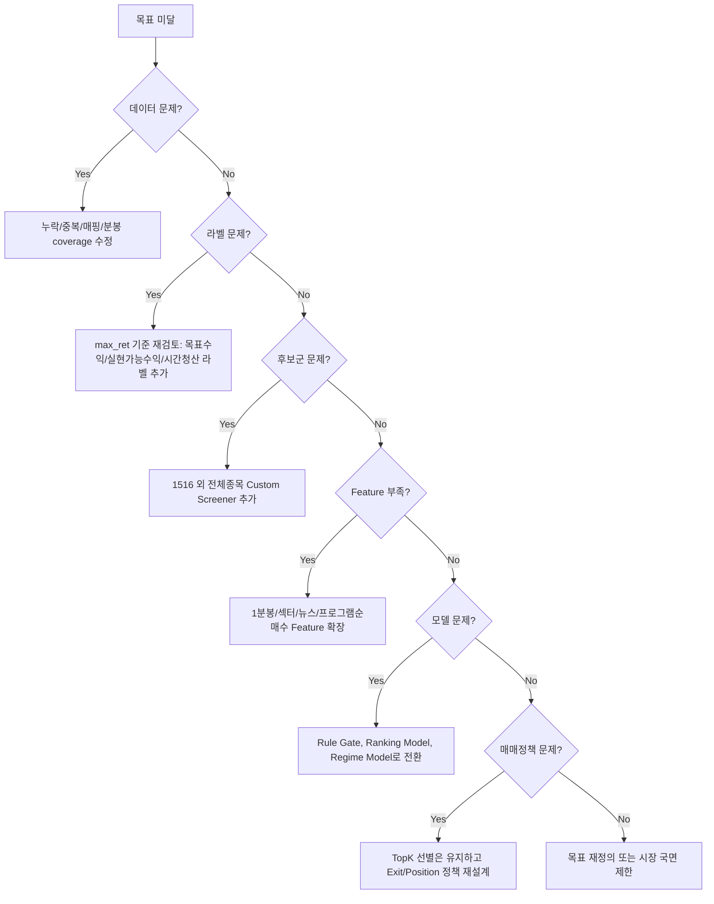

# Contingency Flow: 목표 미달 시 대체 설계

## 1. 전제

`Leader_Lab`의 North Star Metric은 다음이다.

```text
Score Top10 안에 실제 대장주/대박주가 7개 이상 들어오는가?
```

그러나 이 목표는 절대 불변의 방향성이지, 현재 데이터와 초기 feature만으로 반드시 달성된다는 보장은 없다.

따라서 프로젝트는 다음 두 가지를 동시에 만족해야 한다.

1. 목표는 명확하고 높게 유지한다.
2. 목표 미달 시 어떤 방식으로 접근법을 바꿀지 사전에 설계한다.

목표 미달은 실패가 아니라 다음 중 하나를 의미할 수 있다.

- 데이터 범위 부족
- feature 부족
- 라벨 정의 부적합
- 시장 국면별 로직 분리 필요
- 조건검색 후보군 자체의 한계
- 매수/매도 평가 기준 불일치
- 과최적화 방지 기준이 과도하거나 부족
- 실전에서는 TopK 적중보다 포트폴리오 수익 구조가 더 중요

---

## 2. 최상위 의사결정 플로우

```mermaid
flowchart TD
    A[데이터 확보: performance_result + daily + minute1/minute5] --> B[Baseline 측정]
    B --> C[Feature Group별 단독 검증]
    C --> D[LeaderScore v1 조합]
    D --> E[Train / Validation / Test 검증]
    E --> F{Hit@10 >= 7/10?}

    F -- Yes --> G[PermanentLeaderScore 후보]
    G --> H[실전 매매 시뮬레이션]
    H --> I{수익 구조 유지?}
    I -- Yes --> J[실전 채택]
    I -- No --> K[Exit/매도정책 재설계]

    F -- No --> L{Hit@10 >= 5/10?}
    L -- Yes --> M[부분 성공: Feature/Regime 개선]
    L -- No --> N[접근법 재검토]

    M --> O[국면 분리 / Feature 추가 / Threshold 안정성 검사]
    O --> D

    N --> P[라벨 재정의 / 후보군 재정의 / 데이터 확장 / 모델 방식 변경]
    P --> B
```

---

## 3. 목표 미달 구간별 대응

## 3.1 Hit@10 >= 7개

판정:

```text
강력 통과
```

다음 단계:

- Walk-forward 검증
- 매수/매도 시뮬레이션
- 실시간 계산 비용 검증
- PermanentLeaderScore_vN 후보 등록

단, 바로 실전 채택하지 않는다.

추가 확인:

- 특정 날짜 3일 이하가 성과 대부분을 만들지 않는가
- 특정 종목 5개 이하에 성과가 집중되지 않는가
- Test 성능이 Train 성능의 70% 이상인가
- Score Top10 전부 매수 시 MDD가 감당 가능한가

---

## 3.2 Hit@10 = 5~6개

판정:

```text
부분 성공 / 개선 가능
```

대응:

1. Feature group별 기여도 분해
2. 실패일자 유형 분류
3. 시장 국면 분리
4. 섹터/뉴스/프로그램 순매수 feature 추가
5. 분봉 타임프레임 변경
6. Score Top10 전체 매수 대신 Score Top3~5 집중 시뮬레이션

핵심 질문:

```text
왜 7개가 아니라 5~6개에서 막히는가?
```

검토 항목:

- 일봉 구조가 있는 종목만 잘 맞히는가?
- 분봉 수급이 강한 종목만 잘 맞히는가?
- 뉴스성 급등은 놓치는가?
- 장 초반 급등 후 꺾이는 종목을 과대평가하는가?
- 섹터 동반 상승을 반영하지 못하는가?

---

## 3.3 Hit@10 = 3~4개

판정:

```text
기본 feature 부족 또는 조합 방식 부적합
```

대응:

### A. Feature 확장

- 1분봉 기반 거래대금 가속도
- 3분/5분 기준봉 조립
- 기준봉 고가 돌파 후 유지력
- 기준봉 중간값 이탈 여부
- 장중 고점 갱신 빈도
- 섹터 내 상대강도
- 당일 거래대금 순위 변화
- 프로그램 순매수/외국인/기관 추정 수급
- 뉴스 테마 노출

### B. Score 방식 변경

단순 가중합이 부족하면 다음 방식으로 확장한다.

- Rule Gate + Score 구조
- 2단계 ranking
- 국면별 score version
- Pairwise ranking model
- LightGBM/XGBoost ranking
- Logistic label_10 classifier

### C. 후보군 재정의

키움 1516 후보군만으로 부족하면 자체 조건검색 후보군을 추가한다.

- 전체 종목 1분봉 screener
- 거래대금 상위 N
- 주도섹터 내 상위 N
- 전일 기준봉 후 당일 재돌파 후보

---

## 3.4 Hit@10 <= 2개

판정:

```text
현재 방식은 기준선 수준 / 목표 접근 실패
```

이 경우 feature만 조금 바꾸는 방식으로 시간을 쓰지 않는다.

즉시 다음을 점검한다.

1. 라벨이 올바른가?
2. 후보군이 올바른가?
3. 분석 시점이 올바른가?
4. 데이터에 look-ahead가 없는가?
5. 1516 성과검증 결과가 실전 후보군으로 적절한가?
6. Score가 최고수익률이 아니라 다른 현상을 맞히고 있지는 않은가?

대체 접근:

- Actual Top10을 먼저 클러스터링해 공통 구조 도출
- 날짜별 대장주 공통 feature 역탐색
- 기존 Score 가중합 폐기
- 후보군을 키움 1516에서 자체 screener로 전환
- 매매 가능 수익 기준으로 label 재정의

---

## 4. 실패 원인 진단 트리



---

## 5. 대체 라벨 설계

현재 라벨:

```text
max_ret_in_period 기준 Actual TopK
```

목표 미달 시 추가 라벨을 함께 검토한다.

### 5.1 실현가능수익 라벨

```text
09:05 이후 특정 진입 조건 발생 시
목표수익 3% / 5% / 7% 도달 여부
```

### 5.2 시간제한 라벨

```text
09:05~10:00 내 5% 이상 상승
09:05~11:00 내 10% 이상 상승
```

### 5.3 리스크 조정 라벨

```text
MaxRet는 높지만 선행 drawdown이 큰 종목 감점
```

### 5.4 매매 가능 라벨

```text
스프레드/거래대금/체결 가능성을 고려한 label_tradeable_5 / label_tradeable_10
```

이유:

```text
최고수익률 자체는 사후 최고점 기준이므로 실제 매매 가능성과 다를 수 있다.
```

---

## 6. 후보군 대체 전략

목표 미달 시 1516 후보군만 고집하지 않는다.

### 6.1 1516 기반

- 현재 기준선
- 실제 성과검증 라벨이 명확함
- 과거 실험에 적합

### 6.2 자체 1분봉 Screener 기반

- 전체 종목 대상
- 거래대금/거래량/분봉가속도/섹터강도 기반
- 키움 조건식 한계 우회

### 6.3 혼합 후보군

```text
Candidate = 1516 후보 ∪ CustomScreener 후보 ∪ 거래대금 TopN ∪ 섹터 TopN
```

장점:

- 1516이 놓친 대장주 보완
- 자체 조건검색 성능 비교 가능

---

## 7. 로직 대체 전략

### 7.1 단순 가중합

초기 기본형.

```text
Daily + Minute + Indicator + Sector + RiskPenalty
```

목표 미달 시 바로 고도화한다.

### 7.2 Rule Gate + Score

먼저 강한 필터로 약세 종목을 제거한 뒤 점수화한다.

예:

```text
Gate:
- 당일 거래대금 기준 이상
- 기준봉 존재
- 기준봉 중간값 유지
- 위험종목 제외

Score:
- 고가 재돌파
- 섹터강도
- JMA/SuperTrend
- 거래대금 가속도
```

### 7.3 국면별 모델

시장 국면에 따라 다른 score를 사용한다.

- 지수 상승장
- 지수 하락장
- 테마 장세
- 뉴스 장세
- 급락 후 반등장

### 7.4 Ranking Model

TopK 적중이 목적이면 회귀보다 ranking이 적합하다.

- pairwise ranking
- listwise ranking
- LightGBM ranker
- XGBoost ranker

단, ML은 반드시 다음 조건을 통과해야 한다.

- Walk-forward 검증
- 날짜 단위 split
- look-ahead 제거
- feature leakage 제거
- 단순 rule 대비 유의미한 개선

---

## 8. 피벗 조건

다음 조건이면 현재 접근을 폐기하거나 대폭 수정한다.

```text
1. Hit@10이 3개 이하에서 3회 연속 개선 없음
2. Train에서는 7개 이상이나 Test에서 3개 이하
3. 특정 날짜/종목에 성과 집중
4. Feature를 늘릴수록 Validation 성능 하락
5. Score Top10의 label_10 비율이 baseline 대비 개선 없음
6. 실제 매매 시뮬레이션에서 수익 구조가 깨짐
```

---

## 9. 손실 최소화 설계

목표 미달 시에도 남는 자산:

1. MySQL 데이터 자산
2. 1분봉/일봉 캐시
3. 데이터 품질 검증기
4. TopK 평가 엔진
5. feature builder
6. UI pipeline
7. screener framework

따라서 프로젝트가 목표를 즉시 달성하지 못해도, 다음 방향으로 재사용된다.

- 다른 라벨 검증
- 다른 후보군 검증
- 다른 매매정책 검증
- 실전 모니터링
- 섹터/뉴스/수급 분석

---

## 10. 최종 원칙

목표는 높게 유지하되, 목표 미달 가능성을 설계에 포함한다.

```text
목표: 10개 중 7개 족집게
검증: Train/Validation/Test
미달 시: 데이터 → 라벨 → 후보군 → feature → 모델 → 매매정책 순서로 원인 분해
폐기 기준: 사전에 정의
대체 경로: 사전에 정의
```

이 구조가 없으면 데이터 수집과 UI 구현은 김치국이 된다.

이 구조가 있으면 목표 미달도 다음 개선 방향을 제시하는 실험 결과가 된다.
