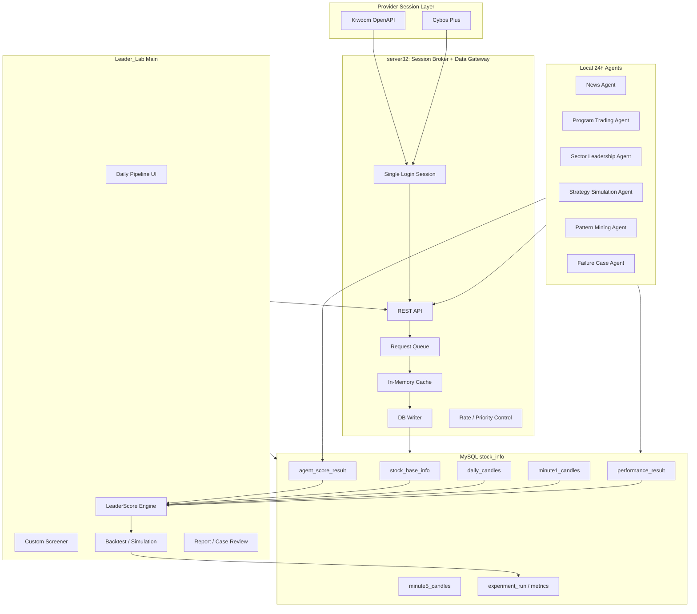
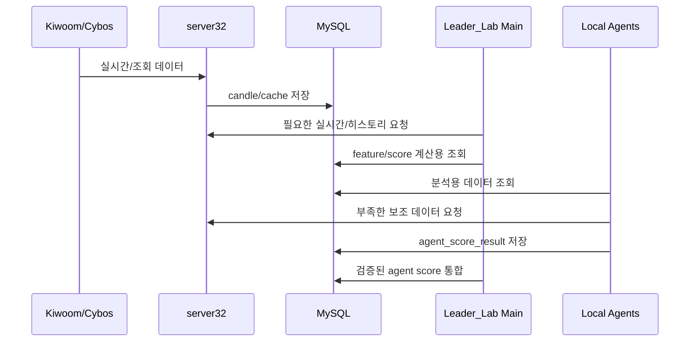
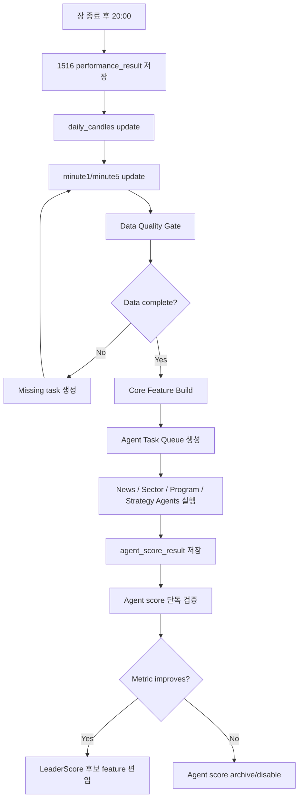
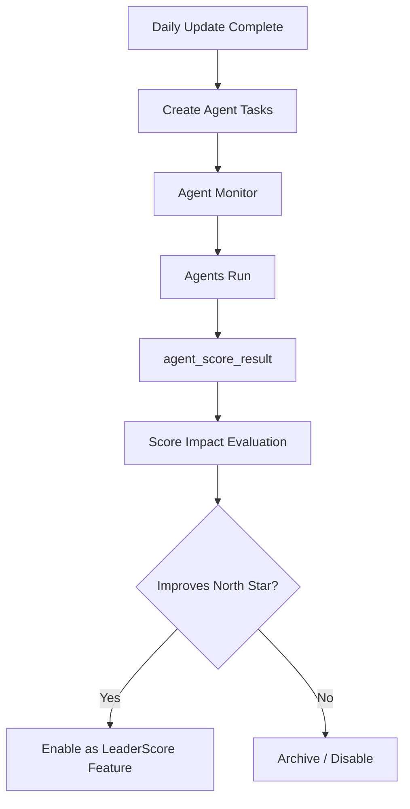

# Server32 중심 Agent 운영 아키텍처

## 1. 목적

`Leader_Lab`은 Kiwoom/Cybos의 단일 로그인/단일 세션 제약을 직접 건드리지 않고, `server32`를 중심으로 여러 분석 Agent와 메인 프로젝트가 같은 데이터 자산을 공유하도록 설계한다.

핵심 목표:

```text
Kiwoom/Cybos 로그인은 server32 하나만 수행
메인 프로젝트와 Agent들은 server32 REST API / MySQL / Cache만 사용
메인 매매/점수화 프로세스에 영향 없이 24시간 분석 Agent 운영
Agent가 만든 점수 요소를 검증 후 LeaderScore에 편입
최종 목적은 Score Top10 안에 실제 대장주/대박주 7개 이상 적중
```

---

## 2. 최종 아키텍처 도식



---

## 3. 역할 분리

### 3.1 server32

`server32`는 증권사 API와 직접 연결되는 유일한 프로세스다.

역할:

```text
1. Kiwoom/Cybos 로그인 유지
2. REST API 제공
3. 히스토리 데이터 다운로드
4. 실시간 데이터 수신/캐시
5. 요청 우선순위 제어
6. 중복 요청 방지
7. MySQL 저장 보조
8. 메인 프로그램과 Agent의 데이터 허브
```

금지:

```text
Agent가 Kiwoom/Cybos에 직접 로그인
메인 프로젝트가 server32를 우회하여 별도 provider 세션 생성
```

---

### 3.2 Leader_Lab Main

역할:

```text
1. Daily Update UI
2. 1516 성과검증 저장
3. 데이터 품질 검증
4. Feature Builder 실행
5. LeaderScore 계산
6. Custom Screener 실행
7. Backtest / Simulation
8. Report / Case Review
```

Leader_Lab Main은 provider 세션을 직접 관리하지 않는다.

---

### 3.3 Local Agents

Agent는 독립 프로세스로 동작한다.

역할:

```text
1. 특정 분석 주제 담당
2. server32/DB에서 데이터 조회
3. 자기 결과를 agent_score_result에 저장
4. 실패/성공 사례를 분석해 다음 실험 후보 제공
5. Core pipeline에 영향 없이 24시간 반복 분석
```

Agent는 원본 테이블을 직접 수정하지 않는다.

허용:

```text
읽기: daily_candles, minute1_candles, performance_result, stock_base_info
쓰기: agent_score_result, agent_run_log, agent_task_queue, experiment suggestion tables
```

금지:

```text
performance_result 직접 변경
daily_candles/minute1_candles 직접 수정
실전 주문 직접 실행
검증되지 않은 score를 LeaderScore에 강제 편입
```

---

## 4. 데이터 흐름

## 4.1 장중 흐름



장중 우선순위:

```text
1순위: 실시간 매매/후보 선별
2순위: 당일 candle/cache update
3순위: 가벼운 Agent score update
4순위: 무거운 백테스트/시뮬레이션은 장후로 이동
```

---

## 4.2 장후 20:00 이후 흐름



---

## 5. 요청 우선순위 큐

server32가 여러 소비자 요청을 동시에 받으면, 메인 프로그램 성능을 보호하기 위해 요청 우선순위가 필요하다.

### Priority Class

| Priority | Type | Example |
|---:|---|---|
| 1 | Main realtime | 실시간 후보/매매 관련 요청 |
| 2 | Daily update | 당일 일봉/분봉 보강 |
| 3 | 1516 post-process | 성과검증 후속 데이터 |
| 4 | Agent light task | 뉴스/섹터 score 갱신 |
| 5 | Heavy research | 대규모 백테스트/전체기간 다운로드 |

### Request Queue 기본 필드

```text
request_id
source_app
priority
request_type
code
timeframe
start_time
end_time
status
created_at
started_at
finished_at
message
```

---

## 6. Agent Task Queue

### 목적

Agent가 임의로 무한 실행되지 않고, 필요한 작업을 표준 task로 받아 처리한다.

### Task 예시

```text
NEWS_ANALYSIS_DAILY
SECTOR_LEADERSHIP_DAILY
PROGRAM_PATTERN_DAILY
STRATEGY_SIMULATION_BATCH
FAILURE_CASE_REVIEW
PATTERN_MINING_TOP_WINNERS
```

### DB 계획

```sql
CREATE TABLE IF NOT EXISTS stock_info.agent_task_queue (
    id BIGINT UNSIGNED NOT NULL AUTO_INCREMENT,
    task_type VARCHAR(50) NOT NULL,
    target_date DATE NULL,
    code CHAR(6) NULL,
    payload_json JSON NULL,
    status VARCHAR(20) NOT NULL DEFAULT 'PENDING',
    priority INT NOT NULL DEFAULT 100,
    locked_by VARCHAR(100) NULL,
    started_at DATETIME NULL,
    finished_at DATETIME NULL,
    message TEXT NULL,
    created_at TIMESTAMP NULL DEFAULT CURRENT_TIMESTAMP,
    updated_at TIMESTAMP NULL DEFAULT CURRENT_TIMESTAMP ON UPDATE CURRENT_TIMESTAMP,
    PRIMARY KEY (id),
    KEY idx_agent_task_status (status, priority, created_at),
    KEY idx_agent_task_date (target_date, task_type)
)
ENGINE=InnoDB
DEFAULT CHARSET=utf8mb4
COLLATE=utf8mb4_0900_ai_ci;
```

---

## 7. Agent Score 표준화

모든 Agent output은 동일한 구조로 저장한다.

```sql
CREATE TABLE IF NOT EXISTS stock_info.agent_score_result (
    id BIGINT UNSIGNED NOT NULL AUTO_INCREMENT,
    trade_date DATE NOT NULL,
    code CHAR(6) NOT NULL,
    agent_name VARCHAR(50) NOT NULL,
    score_name VARCHAR(80) NOT NULL,
    score_value DECIMAL(12,6) NOT NULL DEFAULT 0,
    confidence DECIMAL(8,4) NOT NULL DEFAULT 0,
    reason VARCHAR(500) NULL,
    source_ref VARCHAR(500) NULL,
    expires_at DATETIME NULL,
    created_at TIMESTAMP NULL DEFAULT CURRENT_TIMESTAMP,
    updated_at TIMESTAMP NULL DEFAULT CURRENT_TIMESTAMP ON UPDATE CURRENT_TIMESTAMP,
    PRIMARY KEY (id),
    UNIQUE KEY uk_agent_score (trade_date, code, agent_name, score_name),
    KEY idx_agent_score_date (trade_date, agent_name),
    KEY idx_agent_score_code (code, trade_date),
    KEY idx_agent_score_name (score_name, trade_date)
)
ENGINE=InnoDB
DEFAULT CHARSET=utf8mb4
COLLATE=utf8mb4_0900_ai_ci;
```

### 표준 score 예시

```text
news_heat_score
news_freshness_score
sector_heat_score
sector_leader_score
program_buy_accel_score
strategy_expected_return_score
failure_risk_score
```

---

## 8. Agent Monitor UI 와이어프레임

```text
┌─────────────────────────────────────────────────────────────────────────────┐
│ Agent Monitor                                                               │
├─────────────────────────────────────────────────────────────────────────────┤
│ [Refresh] [Start Agent] [Stop Agent] [Run Pending Tasks] [Disable Agent]     │
├─────────────────────────────────────────────────────────────────────────────┤
│ Agent Status Grid                                                           │
│ ┌──────────────┬─────────┬──────────────┬────────┬────────┬──────────────┐ │
│ │ Agent        │ Status  │ Last Run     │ OK     │ Fail   │ Last Message │ │
│ ├──────────────┼─────────┼──────────────┼────────┼────────┼──────────────┤ │
│ │ News         │ Running │ 20:15:22     │ 125    │ 0      │ OK           │ │
│ │ Sector       │ Idle    │ 20:18:10     │ 874    │ 2      │ Partial      │ │
│ │ Program      │ Disabled│ -            │ 0      │ 0      │ No source    │ │
│ └──────────────┴─────────┴──────────────┴────────┴────────┴──────────────┘ │
├─────────────────────────────────────────────────────────────────────────────┤
│ Task Queue                                                                  │
│ ┌────┬──────────────┬────────────┬──────┬─────────┬──────────────┐         │
│ │ ID │ Task Type    │ Date       │ Code │ Status  │ Message      │         │
│ └────┴──────────────┴────────────┴──────┴─────────┴──────────────┘         │
├─────────────────────────────────────────────────────────────────────────────┤
│ Agent Score Impact                                                          │
│ ┌──────────────┬──────────────┬────────┬────────┬────────┬──────────────┐ │
│ │ Score Name   │ Hit@10 Delta │ Hit@5  │ Lift   │ Used?  │ Verdict      │ │
│ └──────────────┴──────────────┴────────┴────────┴────────┴──────────────┘ │
└─────────────────────────────────────────────────────────────────────────────┘
```

---

## 9. Daily Update UI와 Agent 연결



UI 버튼:

```text
[Create Daily Agent Tasks]
[Run Pending Agent Tasks]
[Evaluate Agent Score Impact]
[Enable Selected Score]
[Disable Selected Score]
```

---

## 10. 실전 안전장치

Agent 구조가 복잡해질수록 안전장치가 필요하다.

```text
1. Agent는 원본 DB를 직접 수정하지 않는다.
2. Agent score는 단독 검증 전 LeaderScore에 편입하지 않는다.
3. Agent 실패는 Core pipeline 실패가 아니다.
4. Agent 결과에는 confidence/reason/source_ref가 있어야 한다.
5. 오래된 Agent score는 expires_at으로 무효화한다.
6. Agent별 성능은 Hit@10 / Label10Rate / PF/MDD로 평가한다.
7. 개선 없는 Agent는 DISABLE한다.
8. 메인 매매 요청은 항상 최우선이다.
```

---

## 11. 구현 단계

### Phase 1. DB / Contract

- agent_task_queue DDL
- agent_score_result DDL
- agent_run_log DDL
- Agent output contract

### Phase 2. Agent Runner Skeleton

- 공통 Agent base class
- task polling
- lock / heartbeat
- run log
- score upsert

### Phase 3. Agent Monitor UI

- Agent 상태
- task queue
- score impact
- enable/disable

### Phase 4. First Agents

- Sector Leadership Agent
- Strategy Simulation Agent
- Failure Case Mining Agent

### Phase 5. LLM Agents

- News Agent
- Pattern Mining Agent
- Failure explanation Agent

### Phase 6. LeaderScore Integration

- Agent score 단독 검증
- score whitelist
- LeaderScore config 편입
- walk-forward 재검증

---

## 12. 핵심 결론

`server32`는 단순 REST 서버가 아니라 다음 역할로 승격되어야 한다.

```text
Market Data Gateway
+ Session Broker
+ Cache Server
+ Agent Data Hub
```

이 구조가 되면 Kiwoom/Cybos 단일 세션 제약에도 불구하고:

```text
메인 프로젝트
+ 뉴스 Agent
+ 섹터 Agent
+ 수급 Agent
+ 전략 시뮬레이션 Agent
+ 실패사례 Agent
```

가 동시에 운영될 수 있다.

하지만 최종 심판은 항상 같다.

```text
Agent를 붙였더니 실제 대장주/대박주 Hit@10이 올라갔는가?
```
