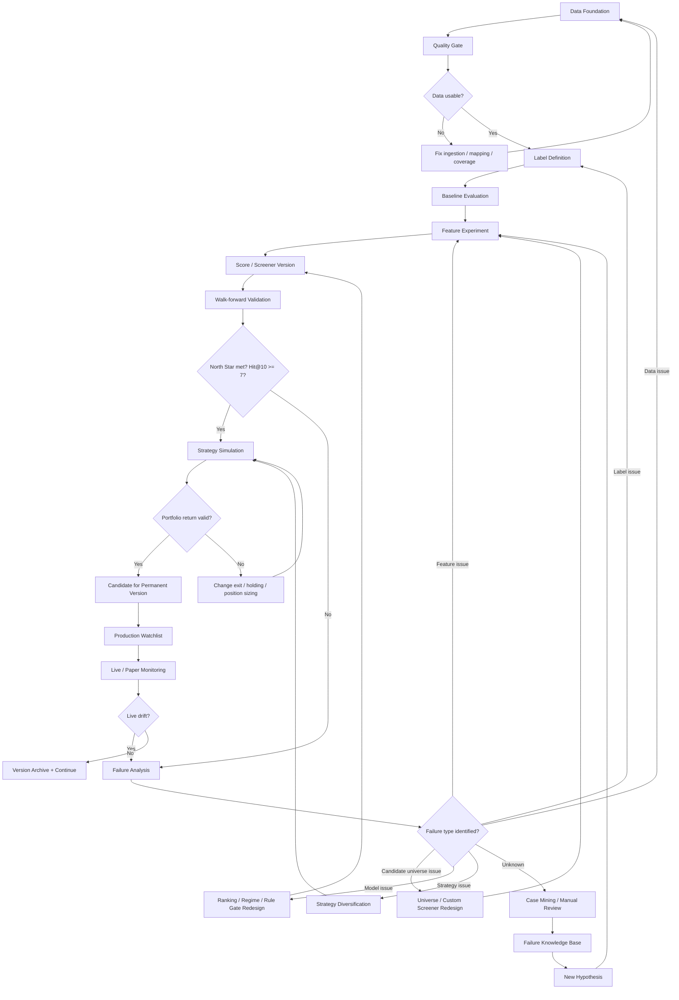
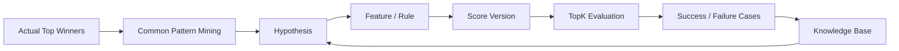
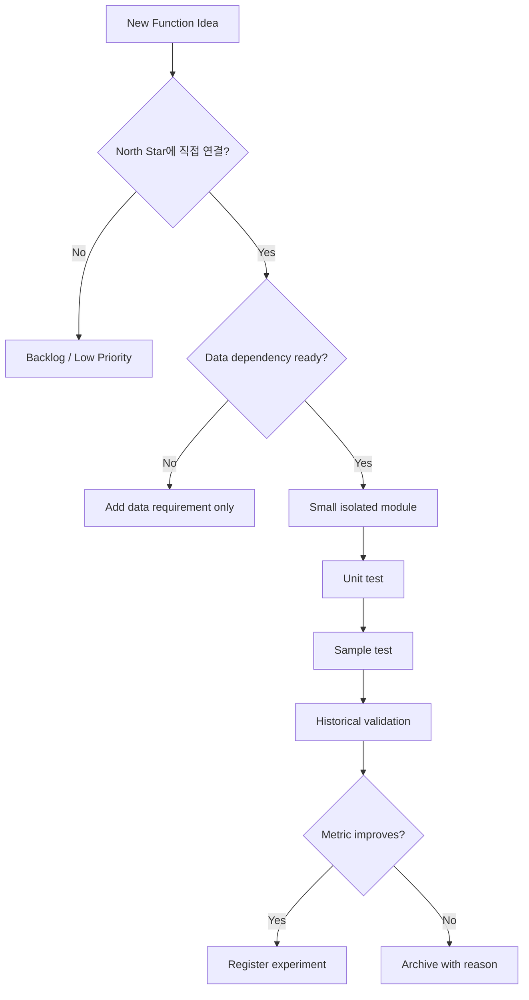
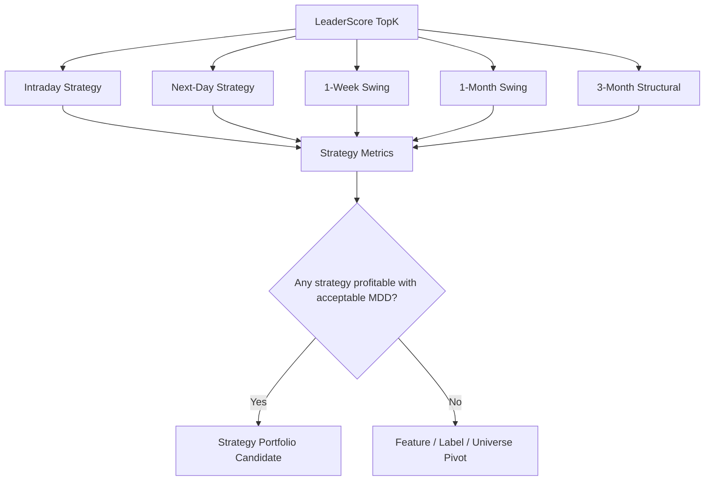

# Sustainable Project Flowchart

## 1. 목적

`Leader_Lab`은 한 번의 대박 로직을 만들기 위한 일회성 프로젝트가 아니다.

목표는 다음이다.

```text
데이터 → 검증 → 실패 원인 축적 → 개선 설계 → 재검증
```

이 선순환 구조를 통해, 설령 특정 버전의 족집게 로직이 실패하더라도 실패 자체가 다음 버전의 설계 자산으로 축적되어야 한다.

즉, 프로젝트가 실패로 끝나는 조건은 다음이 아니다.

```text
Hit@10 7개를 바로 달성하지 못했다.
```

진짜 실패 조건은 다음이다.

```text
왜 실패했는지 기록하지 못했다.
다음 개선 방향을 도출하지 못했다.
성공/실패 사례가 누적되지 않았다.
데이터/로직/평가 구조가 재사용 불가능하게 굳었다.
```

---

## 2. 전체 생존 구조



---

## 3. 프로젝트 동맥경화 방지 원칙

### 3.1 Core와 Experiment 분리

불변 Core:

```text
DB schema
Data loader
Quality checker
Metric evaluator
Report generator
Experiment registry
```

가변 Experiment:

```text
Feature set
Score weights
Filter threshold
Candidate universe
Holding period
Exit policy
Model type
```

원칙:

```text
Core를 자주 고치지 않는다.
Experiment는 설정 파일과 버전으로 바꾼다.
```

---

### 3.2 모든 실험은 버전으로 남긴다

실험 결과는 버려지면 안 된다.

필수 저장 항목:

```text
experiment_id
version_name
feature_set
score_config
candidate_universe
entry_policy
exit_policy
holding_horizon
train_period
validation_period
test_period
metrics
failure_reason
next_action
created_at
```

결과:

```text
성공 사례도 자산
실패 사례도 자산
```

---

### 3.3 실패를 분류하지 못하면 다음 구현 금지

실패한 로직이 있으면 바로 다음 코드를 만들지 않는다.

반드시 먼저 분류한다.

```text
1. 데이터 부족/오류
2. 라벨 정의 문제
3. 후보군 문제
4. feature 부족
5. score 방식 문제
6. market regime 문제
7. exit/holding 문제
8. 과최적화 문제
9. 실시간 적용 불가
10. 원인 미상
```

원인 미상은 `case mining` 대상으로 보낸다.

---

## 4. 선순환 루프



핵심:

```text
Actual Top Winners를 먼저 본다.
그들이 공통적으로 가진 사전 조건을 찾는다.
그 조건을 feature/rule로 만든다.
Score TopK가 실제 TopK와 일치하는지 본다.
성공/실패 케이스를 다시 지식화한다.
```

---

## 5. 실패 지식베이스 설계

### 5.1 failure_case 테이블

목적:

```text
Score가 높았지만 실패한 종목과, 실제 대장주였지만 Score가 낮았던 종목을 누적한다.
```

필수 컬럼:

```text
id
experiment_id
case_type
trade_date
code
name
score_rank
actual_rank
score
max_ret
label_10
primary_failure_reason
secondary_failure_reason
feature_snapshot_json
chart_context_json
review_note
created_at
```

case_type:

```text
FALSE_POSITIVE: Score는 높았지만 실제 수익률 낮음
FALSE_NEGATIVE: 실제 대장주였지만 Score 낮음
TRUE_POSITIVE: Score도 높고 실제 대장주
TRUE_NEGATIVE: Score도 낮고 실제 약세
```

---

### 5.2 success_case 테이블

목적:

```text
맞힌 사례의 공통 구조를 누적한다.
```

필수 컬럼:

```text
id
experiment_id
trade_date
code
name
score_rank
actual_rank
max_ret
winning_pattern
feature_snapshot_json
review_note
created_at
```

---

## 6. 실험 레지스트리 설계

### 6.1 experiment_run

```text
id
experiment_name
version
status
start_date
end_date
train_start
train_end
valid_start
valid_end
test_start
test_end
config_path
result_path
started_at
finished_at
message
```

### 6.2 experiment_metric

```text
experiment_id
metric_name
train_value
valid_value
test_value
all_value
verdict
```

### 6.3 experiment_decision

```text
experiment_id
decision
reason
next_action
reviewed_at
```

의사결정 값:

```text
PROMOTE
RETRY
PIVOT_FEATURE
PIVOT_LABEL
PIVOT_UNIVERSE
PIVOT_STRATEGY
ARCHIVE_FAIL
```

---

## 7. 기능 확장 플로우

새 기능은 반드시 아래 관문을 통과해야 한다.



이 플로우를 통과하지 않는 기능은 프로젝트를 비대하게 만들 뿐이다.

---

## 8. 전략 다변화 플로우



핵심:

```text
당일청산만 실패했다고 프로젝트를 폐기하지 않는다.
상승 초입 포착이 된다면 1주/1개월/3개월 전략으로 수익화 가능성을 검증한다.
```

---

## 9. UI가 지원해야 할 지속 가능성

UI는 단순 실행 버튼 모음이 아니다.

UI는 다음을 보여야 한다.

```text
1. 오늘/기간 데이터가 완전한가?
2. 어떤 실험이 어떤 결과를 냈는가?
3. 어떤 사례를 맞혔고 어떤 사례를 놓쳤는가?
4. 실패 원인은 무엇으로 분류되었는가?
5. 다음 액션은 무엇인가?
6. 이전 실패와 비교해 개선되었는가?
```

필수 탭:

```text
Data Pipeline
Quality Gate
Experiment Board
Case Review
Strategy Lab
Report Archive
Knowledge Base
```

---

## 10. 최소 영구 산출물

이 프로젝트가 중간에 실패해도 반드시 남아야 할 산출물:

```text
1. 정제된 performance_result
2. daily_candles / minute1_candles
3. TopK 평가 엔진
4. experiment_run / metric / decision 기록
5. success/failure case library
6. feature builder
7. screener framework
8. strategy backtest framework
9. 실패 원인 분석 보고서
```

이것이 남으면 다음 프로젝트는 처음부터 다시 시작하지 않는다.

---

## 11. 최종 생존 조건

프로젝트가 건강하게 성장하려면 다음 조건을 만족해야 한다.

```text
1. 데이터는 누적된다.
2. 실험은 버전으로 남는다.
3. 실패는 분류된다.
4. 성공은 패턴화된다.
5. 지표는 항상 같은 기준으로 비교된다.
6. Core는 안정적이고 Experiment는 자유롭다.
7. UI는 실행보다 검증과 의사결정을 돕는다.
8. 목표 미달 시 대체 경로가 있다.
9. 당일/스윙/중기 전략으로 수익화 경로를 다변화한다.
10. Permanent 버전만 실전에 승격한다.
```

---

## 12. 핵심 문장

`Leader_Lab`은 맞히는 로직 하나를 만드는 프로젝트가 아니다.

```text
맞힌 이유와 틀린 이유가 계속 누적되어,
다음 로직이 이전 로직보다 강해지는 구조를 만드는 프로젝트다.
```

이 구조가 유지되면 첫 번째 족집게 로직이 실패해도 프로젝트는 실패하지 않는다.
